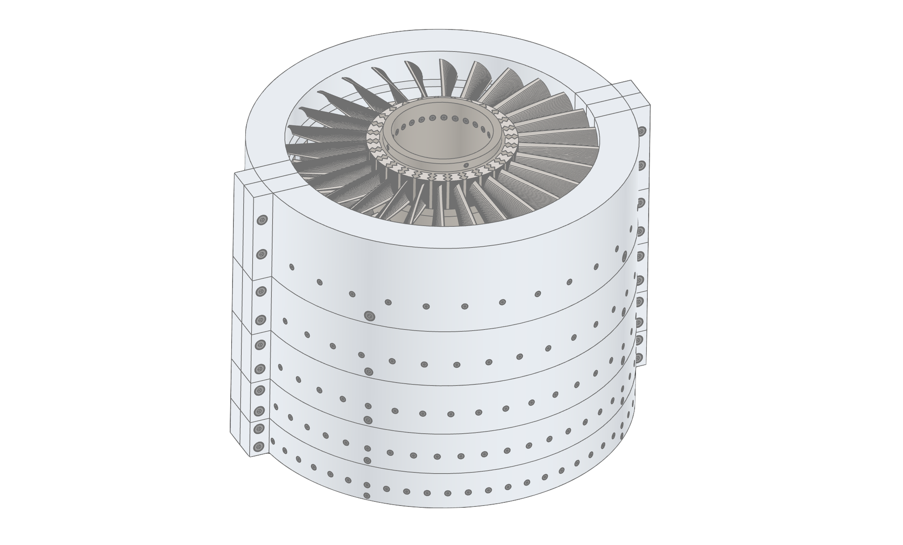
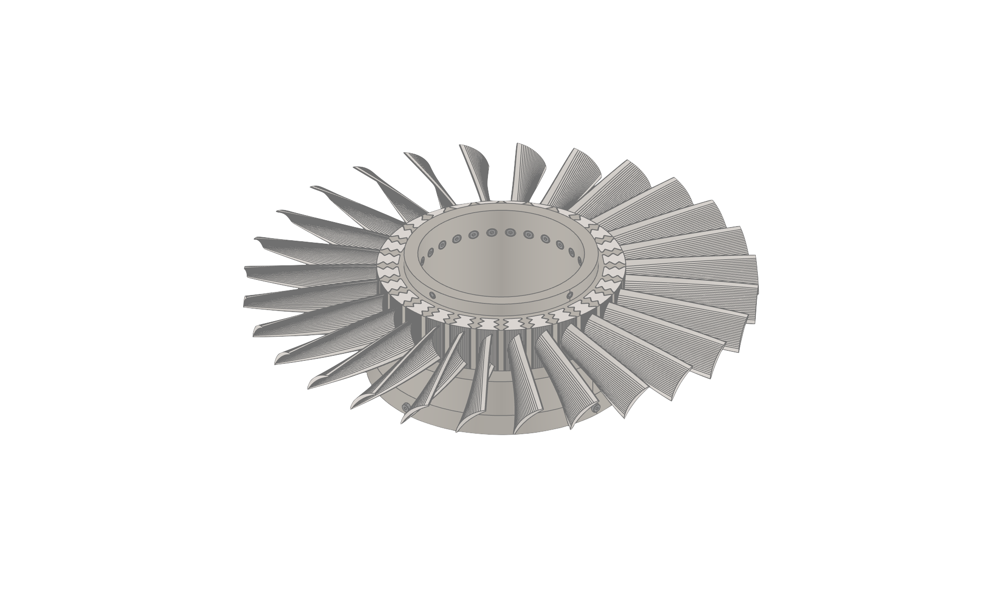
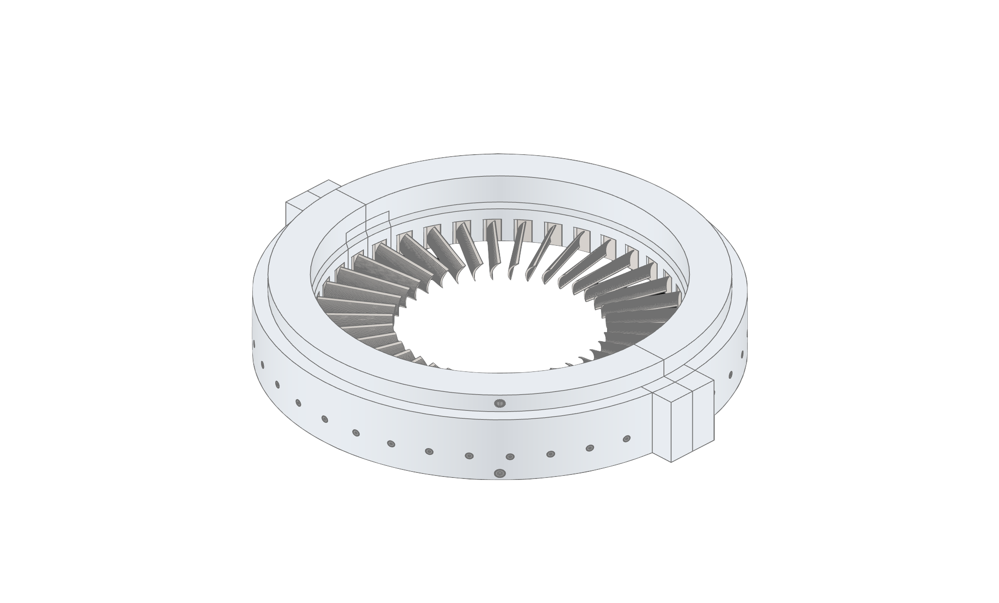

# MicroAxial

**Mean-line design, screening checks and off-design estimation for micro-turbojet and UAV axial compressors.**

MicroAxial takes engine-level requirements (mass flow, pressure ratio, shaft speed) and produces a
sized axial compressor: annulus, stage count, velocity triangles, blade-row geometry and airfoil
sections. It then checks the result against ranges appropriate for *small* machines and estimates
how the compressor behaves away from its design point, including surge margin.

It is a conceptual and preliminary design tool. It is meant to narrow a design space quickly before
committing to 3-D CFD or hardware, not to replace either.

---

## Why micro-scale needs its own checks

Textbook axial compressor practice assumes large blades. Below roughly 1 kg/s the problem changes:

| Effect | Consequence |
|---|---|
| Short blades (last stages under about 8 mm) | Tip clearance dominates losses and stall margin |
| Chord Reynolds number near 1e5 | Profile loss rises; laminar separation risk |
| High shaft speed (50-100 krpm) to reach useful tip speed | Stress, bearing and rotordynamics limits arrive early |
| Few, small blades | Manufacturing tolerances become a large fraction of geometry |

MicroAxial reports these quantities per stage and flags values outside recommended micro-compressor ranges.

---

## Features

**Design**
- Mean-line stage-by-stage velocity triangles with free-vortex radial distribution
- Blade-row sizing: chord, height, solidity, blade count, aspect ratio, thickness
- Johnsen-Bullock incidence/deviation metal angles and double-circular-arc airfoil sections
- Optional CAD export (blades, disks, shaft, casing) through CadQuery

**Micro-turbojet metrics** (per stage, per row, hub to tip where relevant)
- Tip speed, blade-tip Mach number, inlet relative Mach number (rotor tip, mean, hub)
- Chord Reynolds number on relative velocity
- Flow coefficient and stage loading coefficient
- de Haller number and Lieblein diffusion factor (row minimum / maximum over span)

**Micro gas turbine design mode**
- `size`: first-pass annulus, tip speed and stage count from requirements
- `checks`: every stage and row screened against recommended ranges with ok / warn / fail status

**Off-design estimation**
- Stage-stacked compressor map: speed lines, surge line, choke limit
- Running line and surge margin at each speed
- Interactive Plotly map

**Review tables**
- Machine overview and one-row-per-stage summary

---

## CAD export gallery

Geometry generated by the optional CadQuery export (images are from an inherited example design, not the micro-turbojet default).

<p align="center">
  <br>
  <em>Assembled axial compressor with split casing</em>
</p>

<p align="center">
  <br>
  <em>Rotor disk with blades and fir-tree attachments</em>
</p>

<p align="center">
  <br>
  <em>Compressor casing</em>
</p>

---

## Installation

Requires Python 3.10 or newer.

```bash
git clone --recurse-submodules https://github.com/Pavankreative/microaxial-axial-compressor-design-toolkit-for-micro-turbojets-and-uavs.git
cd microaxial-axial-compressor-design-toolkit-for-micro-turbojets-and-uavs
pip install -e ".[cq]"    # analysis, checks, off-design map, tables, plus CadQuery for CAD export
pip install -e ".[test]"  # adds pytest
```

The CAD helper libraries (`cq_warehouse`, `jupyter-cadquery`) live in the `libs/` git submodules, so clone with
`--recurse-submodules` (or run `git submodule update --init` afterwards). If `libs/` is empty, importing the CLI fails
with `ModuleNotFoundError: No module named 'cq_warehouse'`.
The CLI and design-state modules import the CAD layer at load time, so the `cq` extra and the submodules are needed even
when you only run analysis.

> Tip: the repository name is long. If you rename it on GitHub (for example to `MicroAxial`), GitHub redirects the old URL,
> and you can shorten the commands above.

---

## Quick start

### 1. Size a starting point

```bash
microaxial axial compressor size --mass-flow 0.6 --pressure-ratio 3.2 --rpm 64000
```

```
Tip radius                47.7 mm
Hub radius                32.4 mm
Tip speed                  319 m/s
Mean blade speed           268 m/s
Axial velocity             148 m/s
Overall dTt              137.9 K
Stage dTt (target)        28.7 K
Stages (rounded up)          5
Tip relative Mach         1.05
```

Sizing assumes `phi = 0.55`, `psi = 0.40`, hub-to-tip 0.68 by default; all are options.
Treat it as a first guess: the bundled template below trades one extra stage for lower blade loading.

### 2. Start from the bundled micro-turbojet template

```bash
microaxial axial compressor design init mk1
microaxial axial compressor analyze summary
microaxial axial compressor analyze checks
microaxial axial compressor analyze map --plot map.html
```

### 3. From Python

```python
from microaxial.cli.state import MicroAxialDesign
from microaxial.micro_mode import evaluate_design
from microaxial.offdesign import estimate_map
from microaxial.summary import stage_summary_df

design = MicroAxialDesign.from_file("microaxial/designs/micro_turbojet_default.json").definition

print(stage_summary_df(design))           # stage-by-stage table
print(evaluate_design(design).query("status != 'ok'"))

result = estimate_map(design)
print(result.surge_margin_table())
result.plot("map.html")
```

---

## Default design: 0.6 kg/s micro-turbojet axial compressor

The bundled template (`microaxial/designs/micro_turbojet_default.json`) represents a compressor
for a small UAV turbojet. A 0.6 kg/s core corresponds to very roughly the 150-200 N thrust class (an engine-level estimate that depends on turbine inlet temperature; it is not computed by this tool).

| Parameter | Value |
|---|---|
| Mass flow | 0.60 kg/s |
| Shaft speed | 64,000 rpm |
| Overall pressure ratio | 3.2 |
| Isentropic efficiency | 0.80 (polytropic 0.83) |
| Stages | 6, all R = 0.5 |
| Stage temperature rise | 23.7 K (equal split) |
| Axial velocity | 145 m/s |
| Inlet hub-to-tip ratio | 0.74 |
| Inlet / outlet blockage | 0.05 / 0.08 |
| Inlet conditions | 101,325 Pa, 288.15 K |
| Rotor / stator aspect ratio | 1.2 / 1.4 |
| Rotor / stator pitch-to-chord | 0.70 / 0.70 (solidity 1.43) |
| Rotor / stator max thickness | 6 % / 8 % of chord |
| Streams | 5 |

Resulting machine (from `analyze summary`):

| Quantity | Value |
|---|---|
| Inlet tip radius | 52.3 mm |
| Inlet tip speed | 351 m/s |
| First-rotor tip relative Mach | 0.89 |
| Shaft power | 85.6 kW |
| First / last stage blade height | 14.4 mm / 6.9 mm |
| Flow coefficient | 0.475 (all stages) |
| Stage loading | 0.255 (all stages) |
| Rotor chord Reynolds number | 1.8e5 (stage 1) to 1.4e5 (stage 6) |
| Maximum diffusion factor (over span) | 0.54 (rotor 1) |
| Minimum de Haller number (over span) | 0.74 (stator 1) |
| Micro-mode checks | 123 ok, 3 warn, 0 fail |

The three warnings are real micro-scale limits and are left visible on purpose: blade height in
stages 5 and 6 (7.7 mm and 6.9 mm, below the 8 mm guideline) and a last-stage hub-to-tip ratio of
0.854. Five stages was evaluated and rejected, because the extra loading pushed rotor diffusion
factors past 0.6.

---

## Metrics reference

| Metric | Where | Definition |
|---|---|---|
| Flow coefficient `phi` | `Stage.flow_coefficient` | `Cx / U_mean` |
| Stage loading `psi` | `Stage.loading_coefficient` | `cp dT / U_mean^2` |
| Tip speed | `Stage.tip_speed`, `AxialCompressor.inlet_tip_speed` | `2 pi N r_tip / 60` |
| Blade tip Mach | `BladeRow.tip_blade_mach_number` | `U_tip / a_static` |
| Tip relative Mach | `BladeRow.tip_relative_mach_number` | `W1 / a1` at tip (stator: `C1 / a1`) |
| Chord Reynolds | `BladeRow.chord_reynolds_number` | `rho W1 c / mu` at mean span |
| de Haller | `BladeRow.de_haller`, `.minimum_de_haller` | rotor `W2/W1`, stator `C2/C1` |
| Diffusion factor | `BladeRow.diffusion_factor`, `.maximum_diffusion_factor` | Lieblein, on angle magnitudes |
| Shaft power | `AxialCompressor.shaft_power` | `m cp dTt` (kW) |

Full definitions and sign conventions are in [`METHODOLOGY.md`](METHODOLOGY.md).

---

## Micro design mode

`analyze checks` screens each stage against the recommended windows below.
`ok` is inside the window, `warn` is within 10 % of the window width outside it, `fail` is beyond that.

| Parameter | Recommended | Why it matters at micro scale |
|---|---|---|
| Flow coefficient | 0.45 - 0.70 | Low values give highly cambered blades; high values lose work capability |
| Stage loading | 0.25 - 0.50 | Above about 0.5 diffusion limits usually bind |
| Stage pressure ratio | 1.10 - 1.40 | Small axials rarely exceed about 1.35 without transonic rotors |
| Minimum de Haller | 0.72 - 1.00 | Separation criterion |
| Maximum diffusion factor | 0.20 - 0.55 | Stall onset near 0.6 |
| Rotor tip relative Mach | 0.40 - 1.15 | Shock loss begins near 0.9 |
| Tip speed | 150 - 400 m/s | Stress limit of small wheels |
| Chord Reynolds | 1e5 - 1e7 | Profile loss rises steeply below about 1e5 |
| Blade height | 8 - 60 mm | Tip clearance fraction |
| Hub-to-tip ratio | 0.55 - 0.85 | Keeps blades practical and the shaft stiff |
| Aspect ratio | 0.9 - 2.5 | Short blades vs flutter and bending |
| Solidity | 1.0 - 1.8 | Loading capability |
| Thickness / chord | 4 - 10 % | Manufacturability vs transonic sections |

These are screening heuristics drawn from common compressor design practice, tightened for small
size. They flag designs that deserve a second look; they are not certification limits. Edit
`MICRO_RANGES` in `microaxial/micro_mode.py` to apply your own criteria.

---

## Off-design map and surge margin

The estimator stage-stacks the design velocity triangles. At each speed and mass flow it solves
continuity stage by stage, applies Euler work with the stator exit angle frozen and the rotor exit
angle drifting with incidence, reduces polytropic efficiency with incidence, and marks stall where
a rotor or stator diffusion factor passes 0.6. The design point is reproduced exactly.

Example for the default design (`analyze map`):

| Speed | Surge flow (kg/s) | Surge PR | Running-line PR | Surge margin |
|---|---|---|---|---|
| 80 % | 0.464 | 2.06 | n/a | n/a |
| 90 % | 0.510 | 2.97 | 2.69 | 13.6 % |
| **100 %** | **0.588** | **3.59** | **3.20** | **14.5 %** |
| 105 % | 0.626 | 3.82 | 3.45 | 12.1 % |

At 60-70 % speed the model finds no stall-free flow. That is the usual behaviour of a fixed-geometry,
multi-stage axial compressor at part speed: front stages stall while rear stages choke. It points
to the need for inter-stage bleed or variable stators, not to a numerical failure.

Surge margin is defined as `(PR_surge / m_surge) / (PR_run / m_run) - 1` at constant speed, with
running line `PR - 1 = (PR_d - 1)(m/m_d)^n`, `n = 2` by default.

### Limits of the estimate

Please read these before using the numbers:

- No tip-clearance, endwall-blockage, bleed, variable-geometry or Reynolds-number model
- One mean line per stage; hub stall and tip-leakage-driven surge are not captured
- Incidence-loss and deviation coefficients are generic defaults (`k_inc = 5`, `k_dev = 0.3`)
- Stage-stacked speed lines are steep and the stable window is narrow
- Use it to **compare design candidates and see trends** (speed, loading, solidity), not to predict an absolute surge line

Calibrate `k_inc`, `df_limit` and `design_choke_margin` (`OffDesignSettings`) against rig data or
3-D CFD when available.

---

## Design file format

A design is JSON with a `definition` block. Per-stage inputs accept either a single value or one entry per stage.

```json
{
  "machine_type": "axial",
  "configuration": "compressor",
  "definition": {
    "gamma": 1.4, "gas_constant": 287,
    "mass_flow_rate": 0.6, "rpm": 64000, "pressure_ratio": 3.2,
    "inlet_total_pressure": 101325, "inlet_total_temperature": 288.15,
    "isentropic_efficiency": 0.80,
    "axial_velocity": 145, "hub_to_tip_ratio": 0.74,
    "num_stages": 6, "stage_temperature_rise": "equal",
    "stage_reaction": [0.5, 0.5, 0.5, 0.5, 0.5, 0.5],
    "inlet_blockage": 0.05, "outlet_blockage": 0.08,
    "num_streams": 5,
    "aspect_ratio": {"rotor": 1.2, "stator": 1.4},
    "spacing_to_chord": {"rotor": 0.7, "stator": 0.7},
    "max_thickness_to_chord": {"rotor": 0.06, "stator": 0.08},
    "row_gap_to_chord": 0.25, "stage_gap_to_chord": 0.4
  }
}
```

The last stage supports `R = 0.5` only. `num_streams` must be odd. Run
`microaxial axial compressor design schema` for the full schema.

---

## Project layout

```
microaxial/
  compressor.py      machine-level model (AxialCompressor)
  stage.py           stage velocity triangles and aggregate metrics
  flow_station.py    ideal-gas flow station (static/total/relative quantities)
  blade/             blade rows, vortex distributions, metal-angle methods
  airfoils/          double-circular-arc section generator
  micro_mode.py      micro sizing and recommended-range checks
  offdesign.py       compressor map, surge line, running line, surge margin
  summary.py         machine and stage-by-stage summary tables
  designs/           bundled templates
  cad/, attachments/ CadQuery export and fir-tree attachments
  cli/               command-line interface
METHODOLOGY.md       equations, conventions, assumptions
validation/          independent cross-check script (verify_meanline.py)
tests/               unit and CLI tests
```

---

## Testing

```bash
pytest
```

All 147 tests passed on 2026-10-15 (Python 3.13, with the `libs/` submodules present; about 3.5 minutes). The suite covers flow-station thermodynamics, velocity triangles, deviation methods, blade rows,
the CLI, the new metrics, micro-mode checks, summary tables, and the off-design model (including
exact design-point closure).

---

## What I contributed

MicroAxial builds on [TurboDesigner](https://github.com/OpenOrion/turbodesigner) (Open Orion, MIT). The upstream project
provides the mean-line machine and stage model, flow stations, free-vortex blade rows, metal-angle methods, airfoil
generation, the CadQuery export and the CLI scaffolding. My work is the micro-scale layer on top:

| Area | What I added | Where |
|---|---|---|
| Micro-scale screening | Per-stage and per-row metrics (tip and relative Mach, chord Reynolds number, de Haller, Lieblein diffusion factor over span, blade height, hub-to-tip) and the ok / warn / fail range checks | `microaxial/micro_mode.py`, `stage.py`, `blade/row.py` |
| First-pass sizing | `size` command: annulus, tip speed and stage count from mass flow, pressure ratio and rpm | `microaxial/micro_mode.py` |
| Off-design estimate | Stage-stacked compressor map, surge line, running line, surge margin | `microaxial/offdesign.py` |
| Reporting | Machine overview and stage-by-stage summary tables | `microaxial/summary.py` |
| Reference design | 0.6 kg/s, 3.2 PR six-stage micro-turbojet template, with the accepted warnings documented | `microaxial/designs/micro_turbojet_default.json` |
| Documentation and tests | Methodology document, micro-feature and extended turbomachinery tests, independent cross-check script | `METHODOLOGY.md`, `tests/`, `validation/` |

The upstream CAD export, airfoil and fir-tree attachment code is used largely as inherited, and the gallery images above are
from an upstream example design.

---

## Validation

**Status: verified for internal consistency; not yet validated against hardware or published test data.**

| Level | What it shows | Status |
|---|---|---|
| Unit and CLI tests (`pytest`) | Code behaves as intended; design-point closure of the off-design model | 147 passed (2026-10-15) |
| Independent cross-check (`python validation/verify_meanline.py`) | Overall thermodynamics, stage pressure-ratio chain, loading and flow coefficients, Euler work and continuity recomputed from first principles agree with the package | 41 of 41 checks pass |
| Hand-calculation cases | Textbook mean-line worked examples reproduced to within rounding | Planned |
| Benchmark comparison | Mean-line outputs against a published, open compressor test case (pressure ratio, efficiency, loading, diffusion factors) | Planned |
| Cross-code comparison | Same inputs through the upstream TurboDesigner model, and through a 3-D CFD run, to compare loading, diffusion and off-design trends | Planned |

The cross-check script re-derives the same governing equations, so it catches implementation errors (units, indexing, signs)
but cannot show that the equations match real machines. The micro-scale ranges and the off-design coefficients
(`k_inc`, `k_dev`, `df_limit`) are heuristics until calibrated against rig data or CFD. Treat every number as a first guess
for comparing candidates.

---

## Roadmap

- Tip-clearance loss and its effect on efficiency and stall margin
- Centrifugal stage and axial-centrifugal hybrid for micro-turbojet back ends
- Stage-by-stage matching with a turbine and nozzle for full engine running lines
- Calibration hooks for rig data

---

## License

MIT. See [LICENSE](LICENSE).

> MicroAxial is a derivative work of [TurboDesigner](https://github.com/OpenOrion/turbodesigner) by Open Orion, Inc., used under the MIT License.
